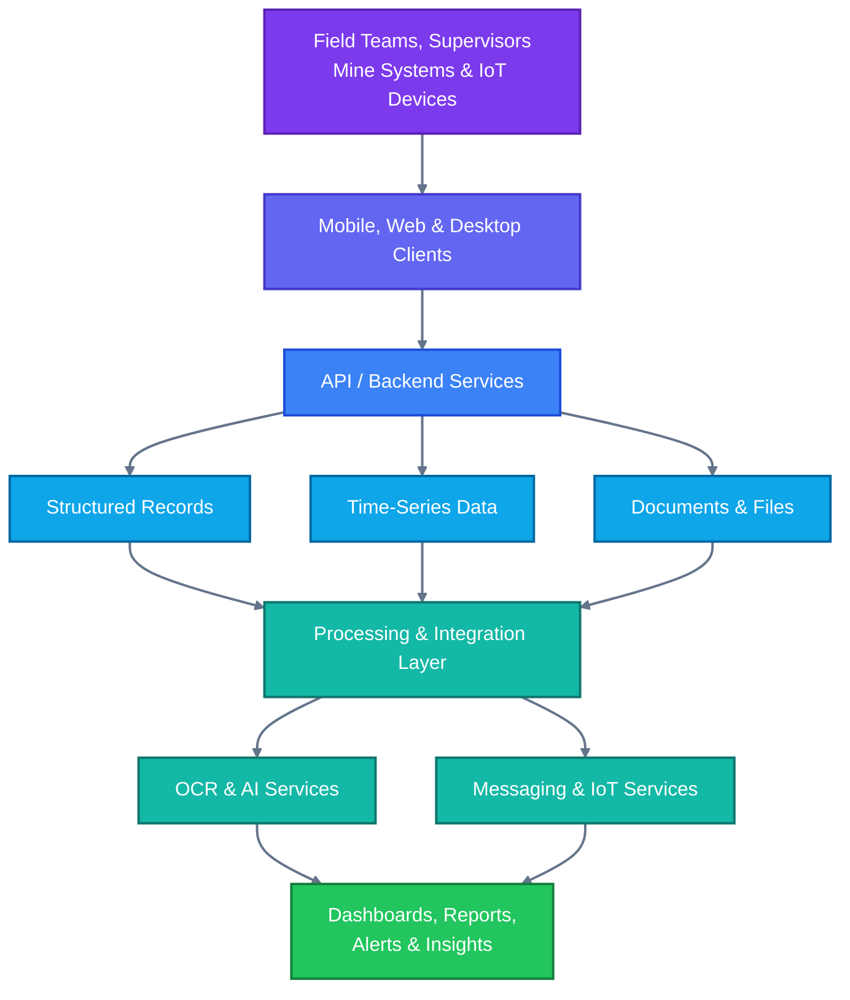

# CoalWorks — AI-Powered Mining Operations

**Team Diet Code**  
*Smarter Mining. Safer Work.*

CoalWorks is a mining-operations platform concept designed to improve productivity, safety, coordination, and compliance in coal mines. It brings supervisor workflows, mobile field reporting, operational dashboards, document digitization, and AI-assisted insights into a connected system.

> **Project status:** This README describes the CoalWorks solution presented in the project deck. The public repository currently contains the `MineGuard-Light/` and `coal mine/` directories; implementation details and run commands should be confirmed against the source code before being treated as production-ready.

## Contents

- [Overview](#overview)
- [Problem](#problem)
- [Solution and Key Capabilities](#solution-and-key-capabilities)
- [Application Surfaces](#application-surfaces)
- [Technical Approach](#technical-approach)
- [Architecture](#architecture)
- [Operational Workflow](#operational-workflow)
- [Expected Impact](#expected-impact)
- [Repository Structure](#repository-structure)
- [Getting Started](#getting-started)
- [Security and Safety Considerations](#security-and-safety-considerations)
- [Roadmap](#roadmap)
- [Team](#team)

## Overview

CoalWorks aims to connect people, equipment, operational records, and safety processes across a mining site. The proposed platform combines:

- **Supervisor tools** for task tracking, shift handovers, and operational oversight.
- **Mobile field workflows** for reporting issues, capturing records, and receiving alerts.
- **Dashboards** for monitoring production, safety, equipment, and compliance indicators.
- **OCR-assisted digitization** to turn paper-based logs and documents into searchable digital records.
- **AI-assisted planning and analysis** to support scheduling, risk awareness, and decision-making.
- **Integration capabilities** for existing mine systems, ERP platforms, and operational logbooks.

The goal is to reduce fragmented workflows and improve the timeliness and traceability of operational information.

## Problem

Mining teams may need to coordinate across paper records, disconnected systems, manual reporting, and limited-connectivity work areas. These conditions can contribute to:

- Delayed communication between field teams and supervisors.
- Repeated data entry and difficult-to-search documents.
- Limited visibility into tasks, equipment status, and safety issues.
- Slow verification of records and compliance-related information.
- Inefficient shift handovers and operational planning.

CoalWorks proposes a connected workflow that helps teams capture information once, share it with the right roles, and make it available for review.

## Solution and Key Capabilities

### 1. Supervisor operations

- Track tasks, work progress, and shift handovers.
- Review field reports and safety alerts.
- Monitor operational status from a centralized dashboard.
- Support coordination between teams and departments.

### 2. Mobile field reporting

- Capture reports and operational updates from mobile devices.
- Record incidents, hazards, and equipment-related issues.
- Receive relevant notifications and alerts.
- Support workflows intended for low-connectivity environments.

*Offline behavior and synchronization policies should be verified in the implementation.*

### 3. AI-assisted planning and insights

- Support operational planning and task prioritization.
- Surface patterns and exceptions from available operational data.
- Assist with risk awareness and decision support.
- Provide insights that can help teams review resource use and performance.

AI outputs should be treated as decision support, not as a replacement for trained personnel, site procedures, or statutory safety requirements.

### 4. OCR and digital records

- Extract text from scanned documents and paper-based logs.
- Make digitized records easier to search and review.
- Support document validation and record verification workflows.
- Reduce repeated manual data entry where extraction quality is sufficient.

OCR output should be checked by an authorized user before being used for compliance or safety-critical decisions.

### 5. Safety and alerts

- Provide a common place to review reported hazards and safety events.
- Route relevant alerts to supervisors and field teams.
- Support tracking from report through review and resolution.
- Help maintain a more consistent record of operational actions.

### 6. System integration

The project deck proposes integration with existing ERP systems, operational logbooks, and mine information systems through APIs and service interfaces. The exact integrations depend on the target site and available systems.

## Application Surfaces

The project deck describes three primary user-facing surfaces:

| Surface | Intended users | Intended purpose |
|---|---|---|
| **Supervisor application** | Supervisors and operations leads | Task tracking, handovers, reports, alerts, and operational oversight |
| **Mobile application** | Field teams and workers | Field updates, reporting, notifications, and access to relevant information |
| **Web/desktop dashboard** | Supervisors, administrators, and management | Cross-platform visibility into records, reports, and operational indicators |

A dedicated safety view is also shown in the concept, focused on reviewing safety-related information and alerts.

## Technical Approach

The project deck presents the following technical building blocks. These describe the proposed architecture; confirm the actual dependencies and versions in the repository before using them as an implementation inventory.

### Data and backend services

- **Time-series storage** for time-based operational or sensor readings.
- **Relational storage** for structured application records.
- **Object storage** for documents and other uploaded files.
- **API services** to connect user applications and backend capabilities.
- **AI services** for assisted analysis and planning workflows.
- **OCR services** for extracting text from documents.
- **IoT services and gateway** for receiving data from connected equipment or sensors.
- **Kafka and ZooKeeper** are shown in the architecture as messaging/infrastructure components.
- **File-system storage** is shown for file handling in the proposed design.

### Frontend and client applications

The deck depicts web/desktop, supervisor, and mobile clients, with real-time updates and operational dashboards. The exact frontend frameworks, build tools, and package versions should be confirmed from the project files.

### Proposed data flow

1. Field users, operational systems, or connected devices produce information.
2. Client applications and gateways submit information to backend services.
3. Services validate and route data to appropriate storage or processing components.
4. OCR and AI capabilities process supported inputs where relevant.
5. Dashboards and mobile/supervisor applications present records, alerts, and insights to authorized users.

This is a conceptual flow based on the deck, not a guarantee that every component is currently implemented in the repository.

## Architecture



The diagram is a simplified conceptual overview, styled with a purple-to-blue-to-teal-to-green color progression. Mermaid's standard flowchart styling uses solid node fills; exact gradient rendering depends on the Mermaid renderer. The deck additionally identifies Kafka, ZooKeeper, an IoT gateway, and separate AI, IoT, and API services as architectural elements.

## Operational Workflow

A representative workflow envisioned by the project is:

```mermaid
flowchart LR
    A(["1 - Capture<br/>Field update, document<br/>or reported issue"]) --> B(["2 - Process<br/>Validate, route<br/>and store information"])
    B --> C(["3 - Review<br/>Check records, reports<br/>and alerts"])
    C --> D(["4 - Coordinate<br/>Assign follow-up actions<br/>and manage handovers"])
    D --> E(["5 - Learn<br/>Reporting, planning<br/>and AI-assisted insights"])

    classDef capture fill:#8b5cf6,stroke:#6d28d9,color:#fff,stroke-width:2px
    classDef process fill:#6366f1,stroke:#4338ca,color:#fff,stroke-width:2px
    classDef review fill:#3b82f6,stroke:#1d4ed8,color:#fff,stroke-width:2px
    classDef coordinate fill:#06b6d4,stroke:#0e7490,color:#fff,stroke-width:2px
    classDef learn fill:#10b981,stroke:#047857,color:#fff,stroke-width:2px

    class A capture
    class B process
    class C review
    class D coordinate
    class E learn

    linkStyle default stroke:#64748b,stroke-width:2px
```



1. **Capture** — a field user or connected system records an update, observation, document, or issue.
2. **Process** — the platform routes the information to the relevant service and storage.
3. **Review** — OCR-assisted records, reports, and alerts are reviewed by authorized personnel.
4. **Coordinate** — supervisors use dashboards and mobile workflows to assign follow-up actions and manage handovers.
5. **Learn** — operational data can inform reporting, planning, and AI-assisted analysis.

## Expected Impact

CoalWorks is designed to support improvements across four areas:

- **Operational efficiency:** less fragmented reporting and improved access to current information.
- **Safety coordination:** faster visibility of reported hazards and clearer follow-up workflows.
- **Social and workforce outcomes:** better coordination and more accessible operational information for teams.
- **Environmental and compliance support:** more consistent records and reporting to assist monitoring and review.

These are intended benefits, not measured outcomes. Any performance figures or impact claims should be supported by validated pilot results before being presented as achieved.

## Repository Structure

The public repository currently lists these top-level directories:

```text
coal-mine/
├── MineGuard-Light/
└── coal mine/
```

The project page does not expose enough file-level detail in the reviewed view to document each directory's contents reliably. Inspect the folders to confirm the active application, entry points, dependencies, and configuration before adding more specific setup instructions.

## Getting Started

### 1. Clone the repository

```bash
git clone https://github.com/khushistar110/coal-mine.git
cd coal-mine
```

### 2. Inspect the project folders

```bash
ls
```

Open `MineGuard-Light/` and `coal mine/` to identify the application you intend to run. On Windows PowerShell, use:

```powershell
Get-ChildItem
```

### 3. Follow the setup for the selected application

Check the selected folder for its project manifest and instructions. Common examples include:

- `package.json` for a Node.js-based application.
- `requirements.txt` or `pyproject.toml` for a Python application.
- `Dockerfile` or `compose.yaml` for a containerized setup.
- `.env.example` for required environment variables.

Install dependencies and run the application using the commands documented by that folder's actual configuration. No framework-specific install or start command is included here because the repository contents could not be verified in enough detail to state one safely.

## Security and Safety Considerations

Because the intended setting is a coal mine, a real deployment should address:

- **Access control:** role-based access for workers, supervisors, and administrators.
- **Data protection:** secure transport, protected secrets, and appropriate retention policies.
- **Auditability:** traceable edits, approvals, and resolution of safety reports.
- **Resilience:** clear behavior during network outages and service interruptions.
- **Human review:** verification of OCR output and AI-generated recommendations.
- **Operational validation:** testing with site personnel and alignment with applicable mine procedures and regulations.

CoalWorks should not be treated as a certified safety system unless and until the necessary validation, approvals, and certifications have been completed.

## Roadmap

The following are suggested next steps for turning the concept into a verifiable implementation:

- [ ] Document the responsibilities and contents of each application directory.
- [ ] Add verified installation and local development instructions.
- [ ] Document environment variables and service dependencies.
- [ ] Add screenshots or a short demo of implemented workflows.
- [ ] Describe API endpoints and data models.
- [ ] Add automated tests and a reproducible development environment.
- [ ] Validate offline workflows, alert delivery, and data synchronization.
- [ ] Evaluate OCR and AI outputs with representative, approved test data.
- [ ] Document deployment, monitoring, backups, and recovery procedures.

## Team

**Team Diet Code**

- Khushi Aggarwal
- Anuska Tuli
- Mehak Aggarwal
- Shalin Kumar

## Acknowledgements and References

The product concept and proposed architecture in this README are based on the *CoalWorks — Team Diet Code* project presentation supplied with the project. Repository-specific details should be updated as the source code is inspected and verified.

- **Repository:** https://github.com/khushistar110/coal-mine

---

<p align="center">
  <strong>CoalWorks</strong><br/>
  Smarter Mining. Safer Work.
</p>
